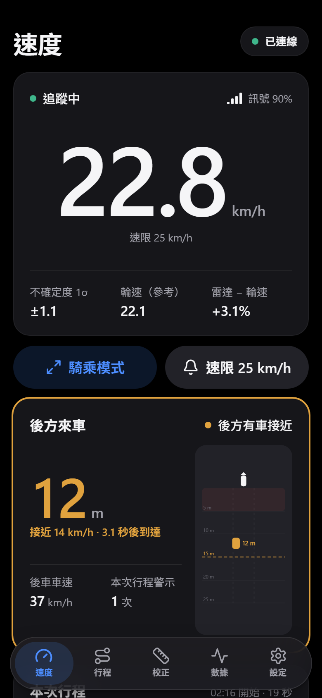
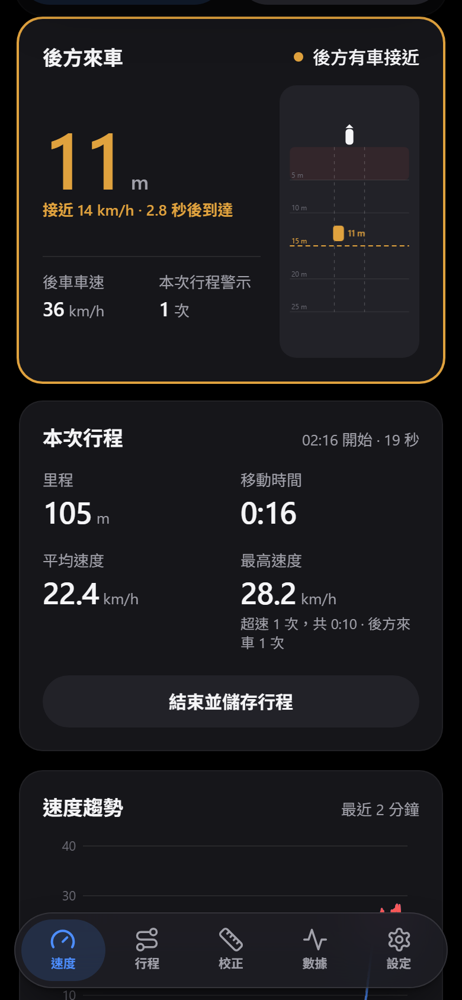
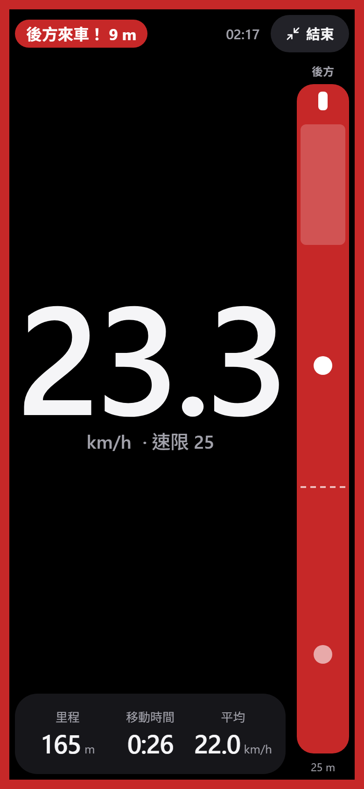
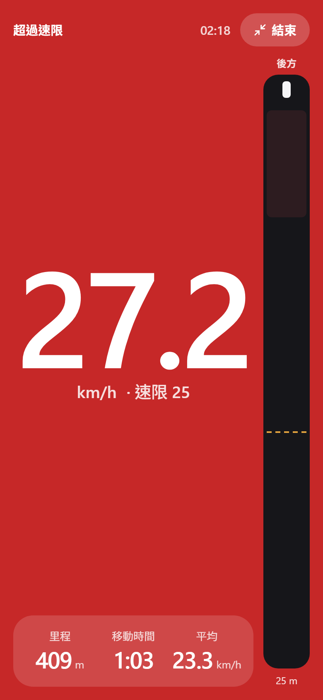
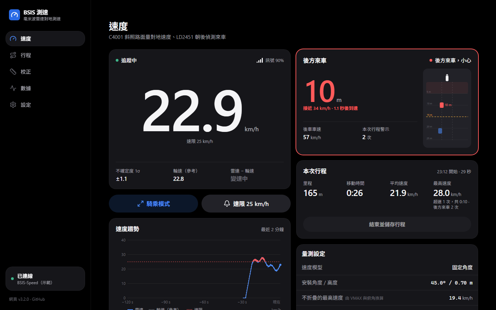
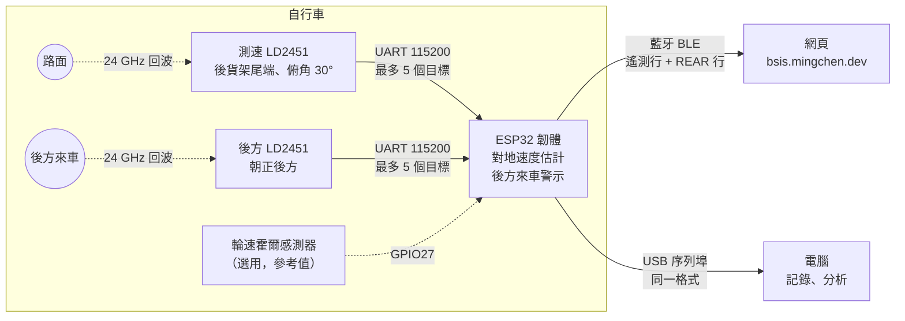

# BSIS 對地測速雷達

> 「智慧自行車動力能源與盲區安全輔助整合系統」（BSIS）的**自身車速與後方來車**子系統。
> 國立彰化師範大學 電機與機械科技學系 專題製作｜指導教授：陳狄成｜組員：蔡宗穎、李振源、林芯瑜

ESP32 同時讀兩顆 HLK-LD2451（24 GHz 毫米波雷達），以藍牙送到網頁顯示：

- **對地測速**：一顆 LD2451 裝在後貨架尾端、**斜向下照路面**，由路面回波的都卜勒速度估計自行車的對地速度與里程（4.0 起；3.x 用 DFRobot C4001）。
- **後方來車**（3.1 起）：另一顆 LD2451 **朝正後方**，後方 15 m 內有車接近就警示（注意／危險），並結合自己的車速算出後車車速（[REAR_RADAR.md](docs/REAR_RADAR.md)）。

3.0 時 C4001 由「後方來車偵測」改為「對地測速」；3.1 再加上 LD2451 專門偵測後方來車；4.0 把測速的 C4001 也換成 LD2451。2.x 舊版保留在 git 歷史（韌體 2.4.0，commit `8a5c3b6`），3.x 的 C4001 程式也在 git 歷史裡。

<p align="center">
  
  
  
  
</p>
<p align="center">
  
</p>
<p align="center"><sub>截圖為示範模式（<code>?demo</code>）的模擬資料。</sub></p>

| | 網址 |
| --- | --- |
| 網頁（手機、電腦；可安裝成 App） | <https://bsis.mingchen.dev> |
| 示範模式（不需要硬體） | <https://bsis.mingchen.dev/?demo> |
| 原始碼 | <https://github.com/Ming874/bsis-radar> |

## 快速開始

| 我想要… | 看這裡 |
| --- | --- |
| 第一次使用：接線、安裝、燒錄、校正、驗收 | **[上手文件](docs/GETTING_STARTED.md)** |
| 把韌體燒進 ESP32（不需要 Arduino IDE） | 雙擊 [`firmware/flash.bat`](firmware/flash.bat) |
| 了解原理、文獻、誤差分析與模擬結果 | [docs/ALGORITHM.md](docs/ALGORITHM.md) |
| 了解 ESP32 ⇄ 網頁的資料格式與指令 | [docs/PROTOCOL.md](docs/PROTOCOL.md) |
| 了解超速警示（預設 25 km/h）的規則與限制 | [docs/SPEED_ALERT.md](docs/SPEED_ALERT.md) |
| 了解後方來車雷達（LD2451）的原理、安裝、警示規則與限制 | [docs/REAR_RADAR.md](docs/REAR_RADAR.md) |
| 修改韌體 | [firmware/README.md](firmware/README.md) |
| 修改網頁 | [web/README.md](web/README.md) |

## 系統架構



**量測原理**：往前騎時，路面相對雷達向後退。雷達量到的徑向速度 v<sub>r</sub> = v·cos θ·cos φ（θ 為俯角、φ 為目標的水平角），所以

```text
v = CAL · |v_r| / (cos θ · cos φ)
```

CAL 是現地校正得到的係數，吸收寬波束造成的偏差（[ALGORITHM.md](docs/ALGORITHM.md) §0、§3）。LD2451 一個資料框最多回報 5 個目標，韌體取方向正確、在距離窗口內的目標的中位數。

**韌體的處理**（[ALGORITHM.md](docs/ALGORITHM.md) §0、§6）：
- 每個資料框挑出路面目標：距離窗口（整數公尺）、水平角、方向、靜止回波，取中位數。
- 等加速度卡爾曼濾波：量測雜訊由二階差分自動估計，過程雜訊依加減速自動切換。
- 靜止／擷取／追蹤／保持／中斷的狀態機。
- 以量測值積分里程。

**網頁**（[web/README.md](web/README.md)）：速度、行程（每筆含速度曲線）、校正、數據、設定五個分頁，加上騎乘模式（全螢幕儀表）。可以安裝成 App（PWA）：用瀏覽器打開會提醒安裝，沒有網路也打得開。

**網頁的超速警示**（[SPEED_ALERT.md](docs/SPEED_ALERT.md)）：對地速度持續 0.5 秒達到速限（預設 25 km/h）時，數字與外框變紅、響兩聲並震動；降到速限 − 1 km/h 以下 1 秒後解除。速限附近的讀值依賴校正。

**後方來車**（[REAR_RADAR.md](docs/REAR_RADAR.md)）：雷達在行進中的腳踏車上，靜止物體與比你慢的車相對雷達都在遠離，LD2451 只回報「靠近」的目標，就只剩從後面追上來的車。ESP32 確認 2 筆後追蹤主要來車：進入 15 m → 注意；5 m 內或到達時間 ≤ 2.5 s → 危險；來車從視野消失（在旁邊超車）後再保持 1.5 秒。網頁顯示距離、接近速度、到達時間、後車車速（＝自己的對地速度＋接近速度），注意／危險各有不同的提示音、震動與（選用）語音；騎乘模式右側有來車直條，警示時直條與畫面邊框變色。

## 精度與限制

| 項目 | 預期 | 依據 |
| --- | --- | --- |
| 校正後、同一路面 | 系統偏差約 ±1%；濾波後隨機誤差約 ±3～5% | 文獻與模擬（[ALGORITHM.md](docs/ALGORITHM.md) §0.6、§10） |
| 換到其他乾燥路面 | 再加 ±1～3% | 寬波束的偏差隨路面改變 |
| 潮濕、光滑路面 | 偏低 10～30%，或量不到 | 24 GHz 在鏡面般的路面回波很弱 |
| 量得到路面 | LD2451 是設計來偵測車輛的雷達，斜照路面會不會穩定回報路面、近距離盲區多大還沒實測 | **驗收第一項**（[上手文件](docs/GETTING_STARTED.md) §10.1、[ALGORITHM.md](docs/ALGORITHM.md) §0.7） |
| 超速警示（25 km/h） | LD2451 可量到 120 km/h，沒有 C4001 的測速上限；未校正或潮濕路面讀值偏低，會漏報 | [SPEED_ALERT.md](docs/SPEED_ALERT.md) §2 |
| 後方來車 | 分不出車道（旁邊車道的車也會警示）；彎道上的來車可能不在 ±20° 內；接近速度 < 5 km/h 不警示；只在網頁提示 | [REAR_RADAR.md](docs/REAR_RADAR.md) §9 |

最有效的硬體改進是收窄雷達波束（透鏡或吸波罩），其次是與輪速感測器融合（[ALGORITHM.md](docs/ALGORITHM.md) §11）。

## 目前狀態

| 項目 | 狀態 |
| --- | --- |
| 韌體單元測試與模擬 | 360 項通過（`firmware\arduino.ps1 test`，或在 ESP32 上 `devicetest`） |
| 網頁單元測試、lint、型別檢查 | 111 項通過（`npm test`、`npm run lint`、`npm run build`） |
| 實機（桌上，2026-11-11） | 韌體 4.0.0 已燒錄；兩顆 LD2451 都在 115200 找到、**指令都有回覆**（完整模式），設定都寫得進去（測速：10 m、靠近遠離都回報、1 km/h；後方：25 m、只回報靠近、5 km/h），沒有目標時約每 1.4 秒一個空資料框 |
| 實車驗收 | 待進行，**先做「量得到路面」**（[上手文件](docs/GETTING_STARTED.md) §8、§10.1）：[上手文件](docs/GETTING_STARTED.md) §10 的項目 A～H；後方來車 [REAR_RADAR.md](docs/REAR_RADAR.md) §10 |

## 專案結構

```text
bsis-radar/
├─ README.md
├─ docs/
│  ├─ GETTING_STARTED.md   上手文件：材料 → 接線 → 安裝 → 燒錄 → 校正 → 驗收
│  ├─ ALGORITHM.md         原理、LD2451 測速設計（§0）、文獻、估計器設計、模擬結果、誤差預算
│  ├─ PROTOCOL.md          ESP32 ⇄ 網頁的文字協定與 CSV 格式
│  ├─ SPEED_ALERT.md       超速警示：速限依據、量測可行性、判斷規則、提示方式
│  ├─ REAR_RADAR.md        後方來車雷達 LD2451：規格與實測、安裝、警示規則、限制、驗證
│  └─ images/              README 截圖
├─ firmware/
│  ├─ SpeedRadar/          ESP32 韌體（Arduino）
│  ├─ tests/               電腦端單元測試與模擬器
│  ├─ diagnostics/         LD2451 腳位偵測、騎乘紀錄分析（analyze_ride.py）
│  ├─ release/             預先編譯的韌體（給 flash.bat）
│  ├─ arduino.ps1          編譯、燒錄、監看、測試（電腦或 ESP32 上）、輸出 release
│  └─ flash.bat / .ps1     一鍵燒錄
└─ web/                    網頁（React + TypeScript + Vite，PWA），push 到 main、CI 通過後自動部署
```

## 版本

| 元件 | 版本 | 說明 |
| --- | --- | --- |
| 韌體 | 4.0.0 | 兩顆 LD2451：對地測速＋後方來車。藍牙名稱 `BSIS-Speed`，NVS 命名空間 `speedRadar`；從 3.x 升級時沿用安裝幾何，校正係數回到 1 |
| 網頁 | 4.0.0 | 對應韌體 4.x；連上 2.x、3.x 韌體時提示更新。4.0 配合 LD2451 測速（拿掉 VMAX、RTHR，加上 GSNR、代表目標的角度與訊噪比）；3.2 拿掉校正係數與精度驗證；2.1 加入超速警示；3.0 重新設計手機介面（與 Lodestar 統一的設計語言）、行程頁與速度曲線、騎乘模式、安裝成 App、備份；3.1 加入後方來車（卡片、騎乘模式直條、提示音／震動／語音、行程的警示次數） |
| 舊版 | 韌體 2.4.0／網頁 1.6.0 | 後方來車偵測，commit `8a5c3b6` |
