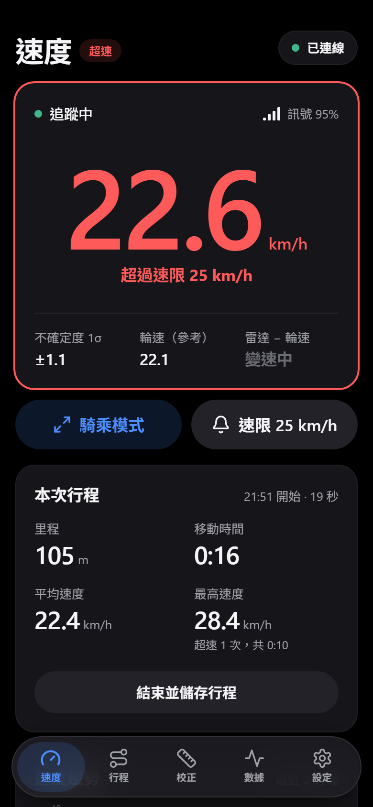
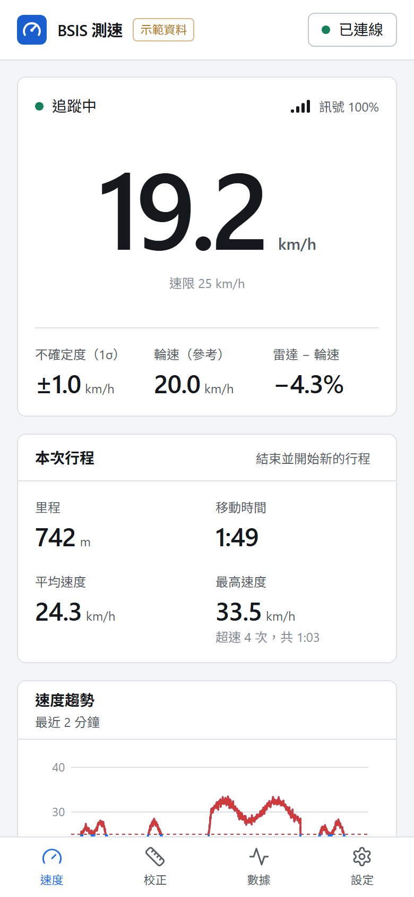
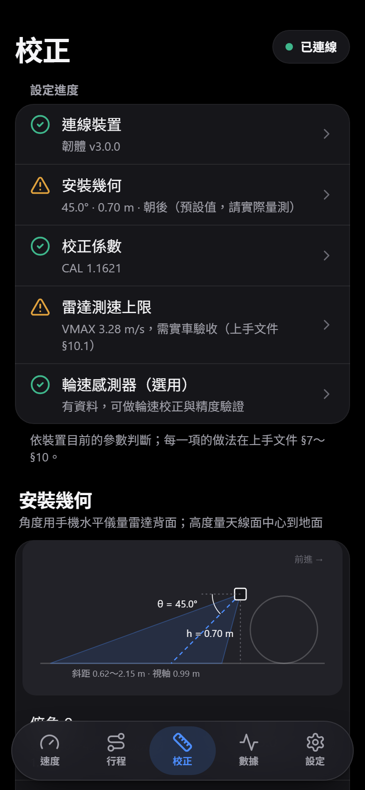
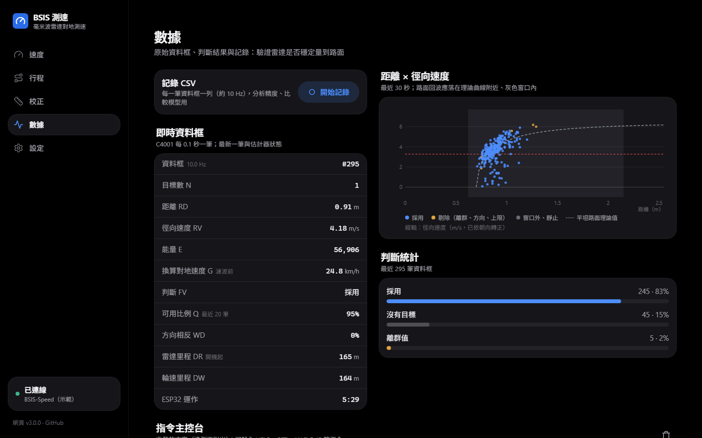
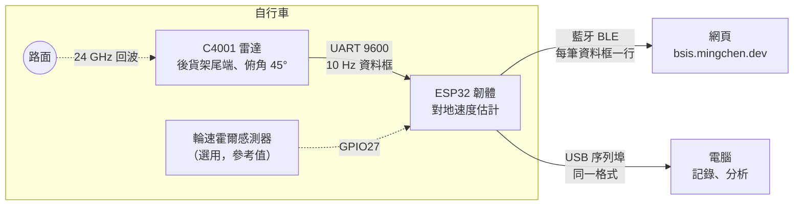

# BSIS 對地測速雷達

> 「智慧自行車動力能源與盲區安全輔助整合系統」（BSIS）的**自身車速**子系統。
> 國立彰化師範大學 電機與機械科技學系 專題製作｜指導教授：陳狄成｜組員：蔡宗穎、李振源、林芯瑜

ESP32 讀取裝在後貨架尾端、**斜向下照路面**的 DFRobot C4001 24 GHz 毫米波雷達。韌體由路面回波的都卜勒速度估計自行車的對地速度與里程，以藍牙送到網頁顯示。

3.0 起，這顆雷達的用途由「後方來車偵測」改為「對地測速」；後方來車改由另一套倒車雷達負責，不在這個 repo。舊版保留在 git 歷史（韌體 2.4.0，commit `8a5c3b6`）。

<p align="center">
  
  
  
</p>
<p align="center">
  
</p>
<p align="center"><sub>截圖為示範模式（<code>?demo</code>）的模擬資料。</sub></p>

| | 網址 |
| --- | --- |
| 網頁（手機、電腦） | <https://bsis.mingchen.dev> |
| 示範模式（不需要硬體） | <https://bsis.mingchen.dev/?demo> |
| 原始碼 | <https://github.com/Ming874/bsis-radar> |

## 快速開始

| 我想要… | 看這裡 |
| --- | --- |
| 第一次使用：接線、安裝、燒錄、校正、驗收 | **[上手文件](docs/GETTING_STARTED.md)** |
| 把韌體燒進 ESP32（不需要 Arduino IDE） | 雙擊 [`firmware/flash.bat`](firmware/flash.bat) |
| 了解原理、文獻、誤差分析與模擬結果 | [docs/ALGORITHM.md](docs/ALGORITHM.md) |
| 了解 ESP32 ⇄ 網頁的資料格式與指令 | [docs/PROTOCOL.md](docs/PROTOCOL.md) |
| 了解超速警示（預設 25 km/h）的規則與限制 | [docs/SPEED_ALERT.md](docs/SPEED_ALERT.md) |
| 修改韌體 | [firmware/README.md](firmware/README.md) |
| 修改網頁 | [web/README.md](web/README.md) |

## 系統架構



**量測原理**：往前騎時，路面相對雷達向後退。雷達量到的徑向速度 v<sub>r</sub> = v·cos θ（θ 為俯角），所以

```text
v = CAL · |v_r| / cos θ
```

CAL 是現地校正得到的係數，吸收寬波束造成的偏差（[ALGORITHM.md](docs/ALGORITHM.md) §3）。

**韌體的處理**（[ALGORITHM.md](docs/ALGORITHM.md) §6）：
- 逐筆有效性判斷：距離窗口、方向、外插資料框、靜止回波。
- 雷達測速上限的折疊還原與自動調整。
- 等加速度卡爾曼濾波：量測雜訊由二階差分自動估計，過程雜訊依加減速自動切換。
- 靜止／擷取／追蹤／保持／中斷的狀態機。
- 以量測值積分里程。

**網頁的超速警示**（[SPEED_ALERT.md](docs/SPEED_ALERT.md)）：對地速度持續 0.5 秒達到速限（預設 25 km/h）時，數字與外框變紅、響兩聲並震動；降到速限 − 1 km/h 以下 1 秒後解除。速限附近的讀值依賴測速上限的驗收與校正。

## 精度與限制

| 項目 | 預期 | 依據 |
| --- | --- | --- |
| 校正後、同一路面 | 系統偏差約 ±1%；濾波後隨機誤差約 ±3～5% | 文獻與模擬（[ALGORITHM.md](docs/ALGORITHM.md) §9、§10） |
| 換到其他乾燥路面 | 再加 ±1～3% | 寬波束的偏差隨路面改變 |
| 潮濕、光滑路面 | 偏低 10～30%，或量不到 | 24 GHz 在鏡面般的路面回波很弱 |
| 測速上限 | C4001 規格互相矛盾（徑向 3 或 10 m/s）。若是 3.28 m/s，45° 時約 16.7 km/h 以上靠折疊還原 | **驗收第一項**（[上手文件](docs/GETTING_STARTED.md) §10.1） |
| 超速警示（25 km/h） | 依賴上一列：C4001 若會截斷，超過約 16.7 km/h 就量不到，無法警示。未校正或潮濕路面讀值偏低，會漏報 | [SPEED_ALERT.md](docs/SPEED_ALERT.md) §2 |

最有效的硬體改進是收窄雷達波束（透鏡或吸波罩），其次是與輪速感測器融合（[ALGORITHM.md](docs/ALGORITHM.md) §11）。

## 目前狀態

| 項目 | 狀態 |
| --- | --- |
| 韌體單元測試與模擬 | 318 項通過（`firmware\arduino.ps1 test`） |
| 網頁單元測試、lint、型別檢查 | 68 項通過（`npm test`、`npm run lint`、`npm run build`） |
| 實機（桌上） | 韌體 3.0.0 已燒錄；C4001 接受地面距離窗口（讀回 `getRange：0.620 2.400`），10 Hz 輸出正常 |
| 實車驗收 | 待進行：[上手文件](docs/GETTING_STARTED.md) §10 的項目 A～H |

## 專案結構

```text
bsis-radar/
├─ README.md
├─ docs/
│  ├─ GETTING_STARTED.md   上手文件：材料 → 接線 → 安裝 → 燒錄 → 校正 → 驗收
│  ├─ ALGORITHM.md         原理、C4001 規格查證、文獻、估計器設計、模擬結果、誤差預算
│  ├─ PROTOCOL.md          ESP32 ⇄ 網頁的文字協定與 CSV 格式
│  ├─ SPEED_ALERT.md       超速警示：速限依據、量測可行性、判斷規則、提示方式
│  └─ images/              README 截圖
├─ firmware/
│  ├─ SpeedRadar/          ESP32 韌體（Arduino）
│  ├─ tests/               電腦端單元測試與模擬器
│  ├─ diagnostics/         C4001 直通程式、騎乘紀錄分析（analyze_ride.py）
│  ├─ release/             預先編譯的韌體（給 flash.bat）
│  ├─ arduino.ps1          編譯、燒錄、監看、測試、輸出 release
│  └─ flash.bat / .ps1     一鍵燒錄
└─ web/                    網頁（React + TypeScript + Vite），push 到 main 自動部署
```

## 版本

| 元件 | 版本 | 說明 |
| --- | --- | --- |
| 韌體 | 3.0.0 | 對地測速。藍牙名稱 `BSIS-Speed`，NVS 命名空間 `speedRadar` |
| 網頁 | 2.1.0 | 對應韌體 3.x；連上 2.x 韌體時提示更新。2.1 加入超速警示 |
| 舊版 | 韌體 2.4.0／網頁 1.6.0 | 後方來車偵測，commit `8a5c3b6` |
