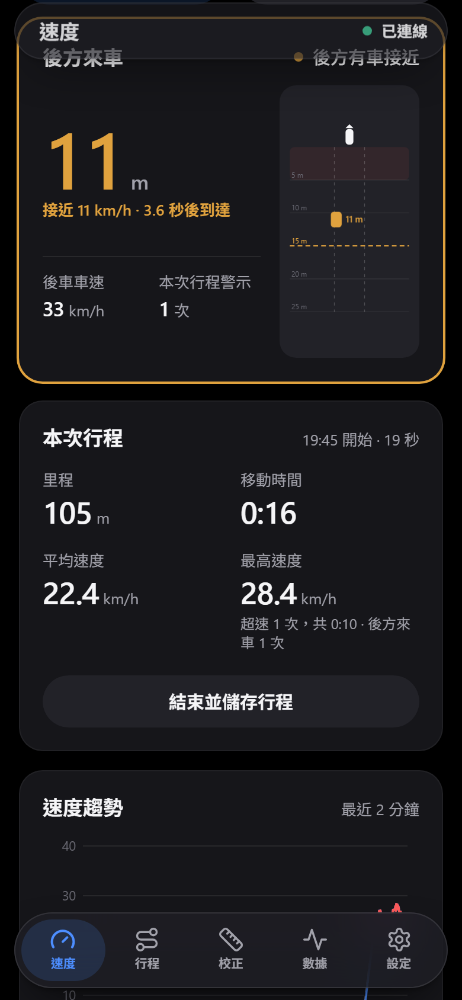
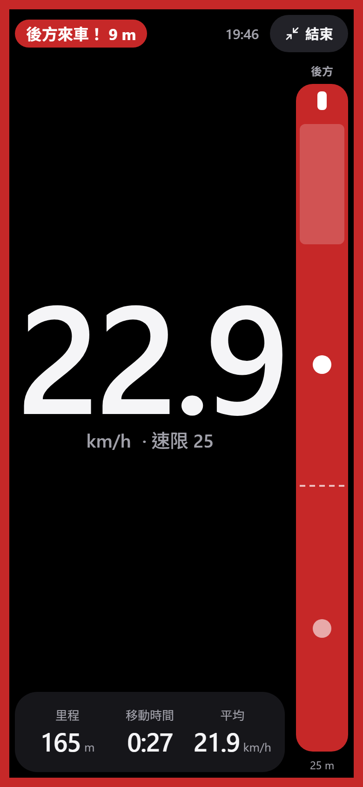
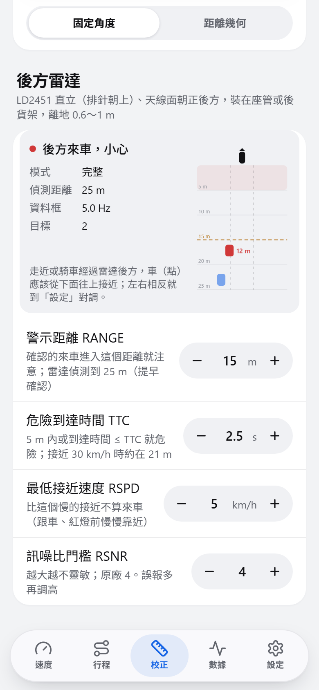

# 後方來車雷達：HLK-LD2451 的分析、設計與驗證

> **對象**：專題組員、指導老師，以及之後要調整警示規則的人。
> **程式碼**：韌體 `firmware/SpeedRadar/src/drivers/LD2451Protocol`（協定）、`LD2451Radar`（驅動）、`src/core/RearThreat`（警示判斷）；網頁 `web/src/domain/rear.ts`（提示規則）、`application/rearAlertStore.ts`、`ui/features/speed/RearCard.tsx`、`ui/widgets/RearRadar.tsx`。測試在 `firmware/tests/host_tests.cpp`（`[LD2451Protocol]`、`[RearThreat]`）與 `web/src/domain/rear.test.ts`。
> **證據等級**：〔規格〕原廠文件；〔開源〕三套以上開源驅動一致；〔實測〕本機實際量到；〔推論〕依資料推得、尚未實測；〔實作〕程式行為，有單元測試。

<p align="center">
  
  
  
</p>

## 摘要

1. **需求**：後方 15 m 內有來車接近就警示並提示。一顆 HLK-LD2451 朝正後方（3.1 起）；4.0 起斜照路面測速的也換成 LD2451，兩顆同型號。
2. **關鍵觀念**：雷達裝在行進中的腳踏車上，量到的是**相對**速度。路面、路樹、停著的車、比你慢的車、交會後的對向車，相對雷達都在「遠離」；只有從後面追上來的車在「靠近」。所以 LD2451 設成「只回報靠近的目標」本身就是來車濾波器〔推論，見 §3〕。
3. **分級**〔實作〕：確認的來車進入 `RANGE`（預設 15 m）→ **注意**；距離 ≤ 5 m 或到達時間 ≤ `TTC`（預設 2.5 s）→ **危險**。高速接近的車（例如接近速度 40 km/h 以上）在 15 m 外就已經是危險，比單純看 15 m 多出 0.5～0.8 秒反應時間（§5）。
4. **兩顆雷達整合**：後車車速 ≈ 自己的對地速度（測速雷達）＋ 接近速度（後方雷達），網頁直接顯示「後車車速」（§7）。
5. **實機查證**（2026-11-04，本機）〔實測〕：LD2451 TX 接在 **GPIO25**、**115200 bps**；沒有目標時約每 **1.39 秒**送一個空資料框；**LD2451 RX 沒有接到 ESP32**（17 支候選腳都沒有指令回覆），所以韌體自動進入「只接收」模式。訊號的高電位偏弱：位元錯誤都是 1 → 0，接收腳加內建上拉後才穩定。之後雷達**完全停止輸出**，需要檢查接線與 5 V 供電（§2.3）。**2026-11-11 重新接線後**〔實測〕：後方雷達在 115200 找到、**指令有回覆**（完整模式，`RO=0`），讀回的設定是 25 m、只回報靠近、5 km/h、延遲 1 s，韌體 V1.19.25070114；同時接上的測速 LD2451 也一樣。
6. **還沒驗證的**：有目標時的資料框頻率、方向位元組的實際意義、角度的正負號、模組目前存的設定。都設計成「不知道也能正確運作」，並列出驗證步驟（§10）。

---

## 1. 需求與範圍

| 項目 | 內容 |
| --- | --- |
| 警示範圍 | 後方 15 m（`RANGE`，可調 5～50 m）內有車接近 |
| 提示 | 網頁：畫面（卡片外框、騎乘模式直條與邊框）、聲音（和超速不同）、震動、語音（選用） |
| 對地測速 | 另一顆 LD2451 斜照路面（4.0 起；3.x 是 C4001），見 [ALGORITHM.md](ALGORITHM.md) §0 |
| 不做 | 判斷車道（1T2R 的角度不夠準）、記錄車牌或影像、控制車燈 |

3.0 時曾規劃由「另一套倒車雷達」負責後方，3.1 起整合進同一塊 ESP32、同一個網頁。

## 2. HLK-LD2451

### 2.1 規格〔規格〕

| 項目 | 值 | 來源 |
| --- | --- | --- |
| 頻率、調變 | 24.00～24.25 GHz，FMCW，掃頻頻寬 < 200 MHz | 使用手冊 V1.00 §6 |
| 天線 | 1 發 2 收（1T2R） | 產品頁 |
| 偵測距離 | 最遠 100 m，可設 10～100 m（手冊寫 0～100） | 手冊 §2、§5.2 |
| 偵測角度 | ±20°（手冊）；產品頁寫「可調 ±15°，涵蓋 3 線道」 | 手冊 §6、產品頁 |
| 速度 | 0～120 km/h，解析度 1 km/h | 手冊 §5.2 |
| 輸出 | 最多 5 個「移動中」目標：角度（1°）、距離（1 m）、方向、速度、訊噪比 | 協定 V1.03（經開源驅動交叉確認） |
| 電源 | **5 V**，供電能力 > 300 mA；平均 107 mA、峰值約 169 mA | 手冊 §5.1、§6 |
| 介面 | UART 3.3 V（原廠 115200 8N1）、OT1（有靠近目標時輸出高電位）、OT2 未使用 | 手冊 §4.2 |
| 藍牙 | 開機廣播 `LD2451_XXXX`，可用 HLKRadarTool App 看資料、改設定 | 手冊 §5.3 |

可設定（存在模組的 flash）：最大偵測距離、偵測方向（0 遠離、1 靠近、2 都要）、最低速度、警報延遲（1～30 s）、累計觸發次數、訊噪比門檻（原廠 4）。

### 2.2 協定〔開源〕

原廠協定 PDF 的網址目前無法下載；以下格式由三套獨立的開源驅動（ESPHome 元件 WizBangCrash/esphome-ld2451、Madproforg/HLK_LD2451、Fiooodooor/HLK-LD245X）互相印證，並用實機資料確認了資料框格式。

```text
資料框（雷達 → ESP32）
F4 F3 F2 F1 | 長度 L（2 bytes，小端） | 目標數 N、警報 | [角度+0x80、距離 m、方向、速度 km/h、訊噪比] × N | F8 F7 F6 F5
沒有目標：F4 F3 F2 F1 00 00 F8 F7 F6 F5（實機擷取）

指令（ESP32 → 雷達）          FD FC FB FA | L | 指令碼 00 [參數] | 04 03 02 01
回覆（雷達 → ESP32）          FD FC FB FA | L | 指令碼 01 狀態（0 成功）[資料] | 04 03 02 01
```

| 指令碼 | 用途 | 參數／回覆資料 |
| --- | --- | --- |
| `FF` | 進入設定 | 參數 `01 00`；回覆含協定版本、緩衝區大小 |
| `FE` | 離開設定 | — |
| `A0` | 讀韌體版本 | 型號 `0x2451`、主版本、次版本 |
| `02` / `12` | 寫／讀目標參數 | 最大距離 m、方向、最低速度 km/h、延遲 s |
| `03` / `13` | 寫／讀靈敏度 | 累計觸發次數、訊噪比門檻、0、0 |

協定**沒有檢查碼**，位元錯誤只能靠格式檢查擋下（§2.3）。

### 2.3 本機實測（2026-11-04）〔實測〕

用診斷程式 `firmware/diagnostics/LD2451Probe` 自動找腳位與鮑率：

| 項目 | 結果 |
| --- | --- |
| LD2451 TX | **GPIO25**（被動監看 19 支候選腳，只有 GPIO25 有電位變化） |
| 鮑率 | **115200**（只有這個鮑率解得出 `F4 F3 F2 F1` 表頭） |
| 沒有目標時 | 每 1394 ms 一個空資料框（偶爾 1673 ms），可以當作「雷達還活著」的心跳 |
| LD2451 RX | **沒有接到 ESP32**：在 17 支可輸出的腳（開汲極與推挽各試一次）送「進入設定」都沒有回覆 |
| 位元錯誤 | 30 秒 21 個資料框中 1 個錯（`F2` → `F0`）；另一次擷取到 `F6 F5` → `F4 F1`。**都是 1 變 0** |
| 與 C4001 同時運作 | 兩顆同時開機，C4001 正常初始化、LD2451 正常輸出（桌上、靜止；騎乘時是否互相干擾尚未驗證）。4.0 換成兩顆 LD2451 後，2026-11-11 桌上同時開機：兩顆都在 115200 找到、指令都有回覆、設定都寫得進去 |

**位元錯誤**〔實測〕：錯誤都是高電位被讀成低電位。接收腳（GPIO25）設成下拉時幾乎每個位元組都錯（`F4 E2 E0 E0 00 00 F0 F6 F4 F0`），不加上下拉時偶爾錯，**加內建上拉後開機偵測 3 次都在 3.6 秒內成功**。所以 LD2451 TX 的高電位驅動偏弱，韌體一律在接收腳開內建上拉（`LD2451Radar::openPort`）。

**之後雷達停止輸出**〔實測〕：同一個下午稍晚，60 秒只收到 10 個空資料框（應有 43 個），中間有超過 4 秒完全沒有位元組；再之後只聽不送 60 秒**一個位元組都沒有**，在 GPIO26 送「離開設定」與「重新啟動」也沒有反應。最後幾次 GPIO25 收到的位元組數剛好等於 ESP32 從 GPIO26 送出的指令（像是兩支腳被接在一起），但前一次測試沒有這個現象，接線可能在測試期間被動過。

**可能原因與要檢查的**〔推論〕：
1. **LD2451 VIN 沒有拿到穩定的 5 V**：有些擴充底板的 V 排針可用跳帽切成 3.3 V（C4001 3.3 V 也能動，所以之前沒發現）；USB 供電不足時 LD2451 的峰值電流（約 170 mA）會讓電壓掉下去。訊號高電位偏弱、斷斷續續、最後完全不輸出，都符合供電不足。**用電表量 LD2451 VIN 對 GND 是否約 5 V**。
2. 杜邦線鬆脫、TX／RX 接錯腳，或 GPIO25、GPIO26 被接在一起（麵包板同一排、焊錫連在一起）。
3. 確認後把 LD2451 斷電再接上（重新開機）。

**韌體的對策**〔實作〕：
- 接收腳開內建上拉（上面）。
- 用「有沒有收到位元組」判斷在線，不用「有沒有解出資料框」：連續兩三個空資料框壞掉時不會誤判離線；15 秒都解不出資料框才重新找鮑率。
- 「進入設定」沒收到回覆就補送「離開設定」：雷達可能收到了指令、只是回覆在線路上壞掉，不補送的話雷達會停在設定狀態、不再輸出資料框。
- 找鮑率時印出每個鮑率收到幾個位元組、幾個格式錯誤的資料框，從序列埠就分得出「沒接」和「訊號不好」。
- 解析器只收格式完全正確的資料框：長度合理、表尾正確、目標數 ≤ 5、長度夠放 N 個目標、方向只能 0／1、速度 ≤ 120 km/h、角度在 ±90° 內。實測的錯誤（表頭、表尾）都會被擋下，`[LD2451Protocol]` 測試用的就是實機擷取到的錯誤位元組。
- 內容裡的位元錯誤（例如距離 14 → 6）格式上看不出來，靠警示判斷擋：單筆跳值不採用，連續 2 筆彼此一致才換追蹤對象（§6）。1 → 0 的錯誤只會讓速度變小（較不危險，不會誤報），距離變小的那一種由跳值閘門擋下。

### 2.4 方向位元組

協定表格寫「方向 0 = 遠離、1 = 靠近」，三套開源驅動也都這樣用；但 Madproforg 的註解指出協定文件的**範例**用 0 表示靠近，兩者矛盾。韌體的處理〔實作〕：

1. 採用表格的定義（`kRearApproachByte = 1`，`src/core/RearFrame.h`），並把雷達設成「只回報靠近」。
2. **距離趨勢核對**：每台追蹤中的車，最近 1.5 秒的距離做最小平方斜率；明確在變遠（> 1.5 m/s）就排除、不警示，並在序列埠印出「回報為靠近的目標距離卻在變遠」。方向判斷錯誤或雷達設定沒寫進去時，不會一直誤報。
3. 方向的實際意義要在實車上確認（§10 第 1 項）；若確認相反，只要改 `kRearApproachByte` 一個常數。

## 3. 為什麼「只回報靠近」就是來車濾波器〔推論〕

雷達量的是目標相對雷達的徑向速度。腳踏車以 v<sub>b</sub> 前進、雷達朝後：

| 物體 | 相對雷達 | LD2451（只回報靠近、最低 5 km/h） |
| --- | --- | --- |
| 路面、路樹、停著的車 | 以 v<sub>b</sub> 遠離 | 不回報 |
| 比腳踏車慢的車、你超越的車 | 遠離 | 不回報 |
| 對向車道的車（交會後） | 遠離 | 不回報 |
| 從後面追上來的車 | 以 v<sub>車</sub> − v<sub>b</sub> 靠近 | **回報** |
| 腳踏車停著（紅燈）時，靜止物體 | 速度 0 | 低於最低速度，不回報 |
| 腳踏車停著時，後方駛來的車 | 以 v<sub>車</sub> 靠近 | **回報** |
| 和你同速跟在後面的車 | 0～4 km/h | 不回報（不算威脅；`RSPD` 可調） |

LD2451 一個資料框最多 5 個目標。如果設成「都要」，騎乘時大量遠離的靜止物體可能佔滿名額、把真正的來車擠掉；設成「只回報靠近」，5 個名額都留給來車。

## 4. 安裝

| 項目 | 要求 | 理由 |
| --- | --- | --- |
| 位置 | 座管或後貨架，天線面朝**正後方** | 波束 ±20° 對準自己的車道 |
| 方向 | 模組**直立、排針朝上**（手冊 §5.4 的安裝照片） | 兩組接收天線左右排列，量的才是水平角度（左右） |
| 高度 | 離地 0.6～1 m | 大約和汽車保險桿、車頭同高 |
| 俯仰 | 水平，或稍微上仰 0～5° | 往下照會照到路面與後輪；上仰太多會漏掉近距離的車 |
| 淨空 | 天線前方不能有擋泥板、反光片、貨架上的東西；外殼不能有金屬 | 24 GHz 會被擋 |
| 背面 | 背後不要有會動的東西（騎士的腳、鏈條）；可加一片金屬板 | 天線有背瓣，背後的動作也會被偵測（手冊 §5.5） |
| 固定 | 鎖緊、不能晃 | 雷達晃動會影響偵測（手冊 §5.5） |
| 電源 | VIN 接 **5 V**（擴充底板 V 排針要確認是 5 V） | §2.3 的位元錯誤 |

覆蓋範圍：15 m 處 ±20° ≈ 左右各 5.5 m，約是自己的車道加旁邊一個車道。

## 5. 時間預算與警示規則

到達時間（TTC）= 距離 ÷ 接近速度。韌體用濾波後的距離與都卜勒速度計算。

| 接近速度 | 從 15 m 到達 | 危險的距離（TTC 2.5 s，至少 5 m） | 第一次警示到到達 | 只看 15 m 時 |
| --- | --- | --- | --- | --- |
| 10 km/h（2.8 m/s） | 5.4 s | 6.9 m | 5.4 s（注意） | 5.4 s |
| 20 km/h（5.6 m/s） | 2.7 s | 13.9 m | 2.7 s（注意 → 0.2 s 後危險） | 2.7 s |
| 30 km/h（8.3 m/s） | 1.8 s | 20.8 m | 2.5 s（危險） | 1.8 s |
| 40 km/h（11.1 m/s） | 1.35 s | 偵測到就危險（25 m） | 約 2.0 s | 1.35 s |
| 50 km/h（13.9 m/s） | 1.08 s | 偵測到就危險（25 m） | 約 1.6 s | 1.08 s |

〔推論〕「第一次警示到到達」扣掉確認的 2 個資料框（約 0.2 s，假設 10 Hz）。

- **為什麼偵測距離是 RANGE + 10 m**：車子進入 15 m 前就先確認、先開始估接近速度，進入時立刻警示；接近速度快的車在 15 m 外就依 TTC 警示。
- **為什麼 TTC 預設 2.5 s**：騎士察覺到反應約 1～1.5 s〔推論〕；汽車前方碰撞警示的測試標準要求警示時的 TTC 約 2.0～2.4 s〔文獻〕[4]。2.5 s 讓接近 20 km/h 的車在 14 m 才變危險，「注意」與「危險」才分得出來（3.0 s 時接近 18 km/h 以上的車一進 15 m 就是危險）。
- **為什麼 5 m 一定危險**：再近就在身邊了，不管接近速度。
- **保持 1.5 s**：車子超過去時會從雷達視野消失（在你旁邊），這時反而最危險，所以警示再保持 1.5 秒。

## 6. 警示判斷（`src/core/RearThreat`）〔實作〕

每個 LD2451 資料框：

1. **候選**：方向是靠近、速度 ≥ `RSPD`、距離 ≤ 偵測距離。只接收模式下雷達用它自己的設定（原廠偵測 100 m），所以 ESP32 一定再篩一次。
2. **主要威脅**：候選中到達時間最短的一個。
3. **確認**：有候選的資料框累積到 2 筆才算來車；沒有候選就扣分（上限 4，漏幾筆不會馬上消失）。
4. **追蹤**：距離用 α = 0.5 的濾波（LD2451 的距離是整數公尺）；接近速度用都卜勒（每筆都有、比距離差分準）。量測和預測差超過「3 m + 接近速度 × 經過時間」先當跳值；連續 2 筆彼此一致才換追蹤對象（另一台車、或真的跳了）。
5. **距離趨勢核對**：§2.4。
6. **分級**：§5。
7. **保持**：§5。700 ms 沒有關聯到量測就放棄追蹤（LD2451 沒有目標時可能隔 1.4 秒才送一筆）。

| 參數 | 值 | 依據 |
| --- | --- | --- |
| `RANGE` | 15 m（5～50） | 需求 |
| `TTC` | 2.5 s（1～6） | §5 |
| `RSPD` | 5 km/h（1～30），寫進 LD2451 | 跟車、等紅燈慢慢靠近不算 |
| `RSNR` | 4（3～8），寫進 LD2451 | 原廠預設；誤報多再調高 |
| 偵測距離 | RANGE + 10 m（10～100），寫進 LD2451 | §5 |
| 確認 | 2 筆 | 單筆雜訊、位元錯誤不警示 |
| 換追蹤對象 | 連續 2 筆一致的跳值 | 位元錯誤 |
| 危險距離 | 5 m | §5 |
| 保持 | 1500 ms | §5 |
| 放棄追蹤 | 700 ms | 資料框頻率未知，約 7 筆（10 Hz） |
| 模組警報延遲／累計觸發 | 1 s／1 次（最小值） | 保持與確認由 ESP32 做，模組不再多等 |

測試（`[RearThreat]`）涵蓋：接近速度 20 km/h 從 24 m 追上來（15 m 注意、約 13.9 m 危險、消失後保持 1.5 秒、警示算一次）、單筆雜訊、遠離／太慢／太遠的目標、5 m 內、位元錯誤造成的跳值、第二台更快的車、回報靠近卻變遠、資料框停止、離線重設、參數改變。

## 7. 兩顆雷達的整合

| 項目 | 做法 |
| --- | --- |
| 硬體 | 同一塊 ESP32、同一套驅動（`LD2451Radar` 兩個實例）：測速雷達用 UART2（GPIO16／17）、後方雷達用 UART1（GPIO25／26），都是 115200、鮑率自動偵測。寫進雷達的方向不同：測速「靠近遠離都回報」、後方「只回報靠近」 |
| 後車車速 | 自己的對地速度（測速雷達，追蹤中才用）＋ 接近速度。來車在旁邊車道時徑向速度略小：15 m、橫向 3 m 時 cos 11° ≈ 0.98，誤差約 2%〔推論〕 |
| 協定 | 原本的遙測行不變；後方另外一行 `REAR …`（有目標或警示中每 0.1 秒、平常每 0.5 秒、等級改變時立刻送），每行都放得進一個藍牙通知（[PROTOCOL.md](PROTOCOL.md) §2.3） |
| 互相干擾 | 4.0 起兩顆是**同型號**的 24 GHz FMCW，掃頻參數相同，照到彼此時比 C4001 + LD2451 更容易出現鬼影或雜訊〔推論〕。方向不同（測速朝後下方、後方朝正後方）；騎乘時若測速雷達的 `Q` 明顯變低或後方雷達常有怪目標，先把兩顆的距離拉開或錯開角度〔推論〕 |
| 行程 | 每趟行程記錄「後方來車警示」次數（韌體的累計值差值，ESP32 重開機時重新對齊） |

## 8. 網頁

| 位置 | 內容 |
| --- | --- |
| 速度頁 | 「後方來車」卡片：主要來車距離（大字）、接近速度、到達時間、後車車速、本次行程警示次數、俯視圖。注意時外框黃、危險時紅 |
| 騎乘模式 | 右側直條（上端是你，車越近點越往上）；注意時直條與畫面邊框變黃、危險變紅，狀態列改成「後方來車！12 m」。超速（整個畫面紅）時危險改成白底紅點 |
| 校正頁 | 「後方雷達」：即時俯視圖（安裝檢查）、模式（完整／只接收）、`RANGE`／`TTC`／`RSPD`／`RSNR` |
| 設定頁 | 「後方來車警示」：開關、提示音、震動、語音、畫面左右對調、測試 |
| 數據頁 | 後方雷達的原始狀態、資料框頻率、每個目標的角度／距離／速度 |
| CSV | 每一列多 `rear_online`、`rear_level`、`rear_distance_m`、`rear_closing_mps`、`rear_ttc_s`、`rear_targets` |

提示音：注意＝1.4 kHz 正弦兩聲（柔和）、危險＝2.8 kHz 方波四聲（急促），和超速（2 kHz 方波兩聲）分得出來。危險時來車還在視野內每 1.5 秒再響；注意在邊界反覆進出時 4 秒內只響一次（`web/src/domain/rear.ts`）。資料中斷、後方雷達離線時**不顯示「安全」**：看不到後面不代表後面沒車。

## 9. 限制與風險

| 限制 | 影響 | 因應 |
| --- | --- | --- |
| 分不出車道 | 旁邊車道的車也會警示 | 1T2R 的角度只當示意；以「寧可多報」為原則 |
| 彎道 | 雷達朝正後方，彎道上的來車可能不在 ±20° 內 | 文件說明；未來可考慮兩顆斜向 |
| 同速跟車 | 接近速度 < `RSPD` 不警示 | 可調低 `RSPD`，但誤報會變多 |
| 只在網頁端提示 | 手機要亮著、藍牙要連著 | 資料中斷時明確顯示；未來可在 ESP32 加蜂鳴器 |
| 位元錯誤 | 漏掉幾筆資料框 | 格式檢查、確認、跳值閘門；檢查 5 V（§2.3） |
| 只接收模式 | 雷達設定無法由 ESP32 寫入（最低速度、訊噪比、方向） | ESP32 再篩一次；接上 LD2451 RX → GPIO26 就會自動寫入 |
| 模組自己的藍牙沒有密碼 | 別人可用 HLKRadarTool 改雷達設定 | 完整模式下 ESP32 每次開機會改回來；只接收模式無法 |
| 解析度 | 距離 1 m、速度 1 km/h | 濾波；TTC 在 15 m、20 km/h 時誤差約 ±0.1 s |
| 有目標時的資料框頻率未知 | 影響確認延遲與追蹤逾時 | 參數依 10 Hz 估計，實測後調整（§10） |

## 10. 驗證步驟

| # | 項目 | 方法 | 合格 |
| --- | --- | --- | --- |
| 1 | 方向位元組 | 在雷達後方 10 m 往雷達走（或推腳踏車），看數據頁「後方雷達」的目標：速度欄應顯示「靠近」、距離變小 | 走近時顯示靠近。若顯示「遠離」，把 `kRearApproachByte` 改成 0 |
| 2 | 角度正負 | 從雷達後方偏左走近 | 俯視圖的點在左邊；相反就在設定頁打開「左右對調」 |
| 3 | 資料框頻率 | 有目標時看數據頁的 Hz | 記錄下來，若遠低於 10 Hz 要加長 700 ms 逾時 |
| 4 | 電源 | 電表量 LD2451 VIN | 約 5 V |
| 5 | 實車偵測率 | 路邊騎 2 km，手機錄影對照；CSV 記錄 | 從後方超車的車 ≥ 95% 在 10 m 前警示 |
| 6 | 誤報 | 空曠道路、沒有車時騎 2 km | 每公里 ≤ 1 次 |
| 7 | 兩顆雷達同時 | 驗收測速精度（[GETTING_STARTED.md](GETTING_STARTED.md) §10）時後方雷達開著 | 測速的結果和不開時一致 |

## 參考資料

1. Hi-Link, *HLK-LD2451 產品頁*（規格、文件下載）. https://www.hlktech.com/en/Goods-245.html
2. Hi-Link, *HLK-LD2451 Vehicle Status Detection Module User Manual V1.00*（2024-05-07）. 經銷商轉載：https://laskakit.cz/user/related_files/hlk-ld2451_user_manual_v1-0.pdf
3. 開源驅動（協定交叉確認）：WizBangCrash/esphome-ld2451（ESPHome 元件）、Madproforg/HLK_LD2451（ESP32 Arduino）、Fiooodooor/HLK-LD245X（Arduino／PlatformIO）. GitHub.
4. NHTSA, *Forward Collision Warning System Confirmation Test*（NCAP）：前車靜止、減速、慢速三種情境，警示時的 TTC 要求約 2.0～2.4 s.
