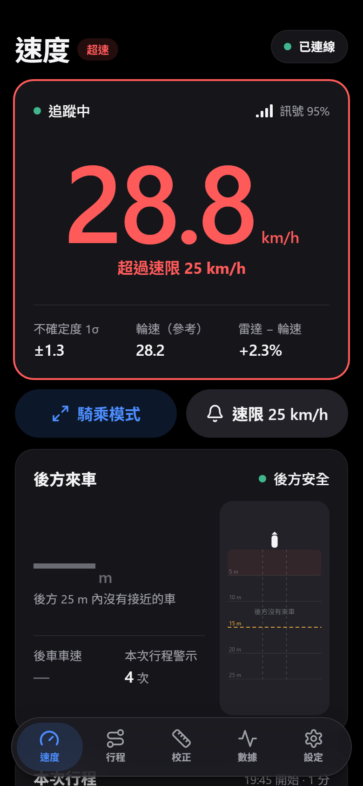

# 超速警示：需求、量測可行性與設計

> **對象**：專題組員、指導老師，以及之後要調整警示規則的人。
> **程式碼**：`web/src/domain/overspeed.ts`（判斷規則）、`web/src/application/overspeedStore.ts`（狀態與提示頻率）、`web/src/infrastructure/alertOutput.ts`（提示音、震動）；測試在同名的 `*.test.ts`。
> **證據等級**：〔法規〕〔文獻〕附編號；〔模擬〕本專案的模擬（[ALGORITHM.md](ALGORITHM.md) §0.6）；〔推論〕依資料推得、尚未實測；〔實作〕本功能的程式行為，有單元測試。

<p align="center">
  
</p>

## 摘要

1. **功能**：雷達量到的對地速度持續 0.5 秒達到速限（預設 25 km/h），速度數字與外框變紅、每一頁的標題旁出現「超速」、騎乘模式整個畫面變紅，並響兩聲、震動。降到「速限 − 1 km/h」以下 1 秒後解除。只在網頁端，不需要改韌體。
2. **25 km/h 的依據**：台灣電動輔助自行車與微型電動二輪車的最大行駛速率〔法規〕[1]；歐盟電動輔助自行車的輔助截止速度也是 25 km/h〔法規〕[2]。可在設定頁或速度頁的「速限」按鈕改成 5～60 km/h。
3. **測速範圍不再是問題，路面回波才是**：4.0 起測速雷達是 HLK-LD2451（0～120 km/h），不像 3.x 的 C4001 在約 16.7 km/h 以上會折疊或截斷。剩下的風險是 LD2451 在 25 km/h 時能不能穩定回報路面，要在驗收 [GETTING_STARTED.md](GETTING_STARTED.md) §10.1 確認。
4. **誤差是不對稱的**：寬波束的讀值系統性偏低。未校正時偏低約 5～15%（4.0 模擬：30° 安裝、乾柏油約 −8.6%），潮濕路面再偏低〔文獻、模擬〕。所以主要的失效是**漏報**（真的超速卻沒警示），很少誤報。網頁 3.2 起不再顯示校正係數，也不會在未校正時提示；從 3.x 升級到 4.0 時 `CAL` 會回到 1。校正方式見 [GETTING_STARTED.md](GETTING_STARTED.md) §9。
5. **延遲約 0.8～1.1 秒**，25 km/h 時約 6～8 m〔推論〕：濾波落後 0.2～0.5 秒、藍牙約 0.1 秒、進入條件 0.5 秒。
6. **只在網頁端的限制**：手機畫面要亮著（設定頁的「保持螢幕常亮」）、藍牙要連著。資料中斷時會解除警示，並顯示「資料中斷」。

---

## 1. 需求與速限

| 來源 | 內容 | 本專案的用法 |
| --- | --- | --- |
| 道路交通管理處罰條例第 69 條 [1] | 電動輔助自行車：以人力為主、電力為輔，最大行駛速率在每小時 25 公里以下。微型電動二輪車（2022-11-30 起由「電動自行車」更名）：以電力為主，最大行駛速率同為 25 km/h | 預設速限 25 km/h |
| 歐盟 (EU) No 168/2013 第 2(2)(h) 條 [2] | 電動輔助自行車的馬達須在 25 km/h 前切斷輔助 | 佐證 25 km/h 是自行車常用的速度界線 |
| 一般自行車 | 本專案不主張一般自行車有法定的數字速限 | 25 km/h 作為安全參考值；速限可調 |

速限存在手機的瀏覽器（`localStorage` 的 `bsis.settings.v1`），不寫進 ESP32。存檔的值不在 5～60 km/h 內時改用 25。

## 2. 25 km/h 量得到嗎

### 2.1 測速範圍與量化

25 km/h = 6.94 m/s。俯角 30° 時，徑向速度 v<sub>r</sub> = 6.94 × cos 30° = 6.01 m/s = 21.6 km/h，遠低於 LD2451 的 120 km/h，不會折疊。

LD2451 的速度是**整數 km/h**：視軸上 1 km/h 的徑向速度 = 1 / cos 30° ≈ 1.15 km/h 的對地速度，所以單一資料框在 25 km/h 附近只有 24.2、25.4… 這樣的格子。實際上路面點分散在不同的俯角、水平角，再加上雜訊，濾波後可以分辨到比一格更細〔模擬：起步後 6 m/s 巡航的速度 RMS 0.17 m/s ≈ 0.6 km/h，[ALGORITHM.md](ALGORITHM.md) §0.6〕。

3.x（C4001）時期的「超出測速上限」狀態與折疊還原，4.0 都拿掉了。

### 2.2 準確度與漏報

速限附近的誤差（25 km/h 時）：

| 誤差源 | 大小 | 25 km/h 時 | 方向 | 依據 |
| --- | --- | --- | --- | --- |
| 未校正（CAL = 1） | 約 −5～−15% | 顯示 21～24 | 偏低 → 漏報 | [ALGORITHM.md](ALGORITHM.md) §3.2、§0.6、GETTING_STARTED §8 |
| 校正後、同一路面的系統偏差 | ±1% | ±0.25 km/h | 雙向 | ALGORITHM §10〔模擬〕 |
| 濾波後的隨機誤差 | ±3～5% | ±0.75～1.25 km/h | 雙向 | ALGORITHM §10〔文獻、模擬〕 |
| 換到其他乾燥路面 | ±1～3% | ±0.25～0.75 km/h | 雙向 | ALGORITHM §3.2 |
| 潮濕或光滑路面 | −10～−30%，或量不到 | 顯示 17.5～22.5 | 偏低 → 漏報 | ALGORITHM §3.4 |
| 加減速時的濾波落後 | 0.2～0.5 秒 | 見 §2.3 | 加速時偏低 | ALGORITHM §6.3 |

結論：
- **校正是超速警示的前提**。未校正時，實際 25 km/h 只顯示約 21～24 km/h，不會警示。
- 大的誤差都讓讀值**偏低**，所以主要風險是漏報。這也是不把速限往下調（例如用 v + σ 判斷）的理由之一：在校正好的情況下，往下調只會增加誤報；在未校正的情況下，往下調也補不回 5～15% 的偏差。

### 2.3 延遲

| 環節 | 時間 | 說明 |
| --- | --- | --- |
| LD2451 資料框 | 0～0.1 秒 | 有目標時連續輸出，估計約 10 Hz（待實測） |
| 卡爾曼濾波落後 | 0.2～0.5 秒 | 等加速度模型，等加速度段沒有穩態落後（ALGORITHM §6.3） |
| 藍牙通知 | 約 0.05～0.1 秒〔推論〕 | 每筆資料框一行 |
| 進入條件 | 0.5 秒 | §3.2 |
| **合計** | **約 0.8～1.1 秒** | 25 km/h 時約 5.6～7.6 m |

以 0.5～1 m/s² 加速越過 25 km/h 時，警示出現時的實際速度約 26.4～29 km/h〔推論〕。

## 3. 判斷規則

### 3.1 每一筆遙測的意義

`overspeedEvidence()` 把韌體的估計器狀態（`ST`）與速度（`V`）轉成四種結果：

| 狀態 | 結果 | 理由 |
| --- | --- | --- |
| 追蹤，V ≥ 速限 | 超過 | |
| 追蹤，速限 − 1 km/h ≤ V < 速限 | 維持現狀 | 遲滯帶 |
| 追蹤，V < 速限 − 1 km/h | 低於 | |
| 保持 | 維持現狀 | 韌體沿用估計值最多 2 秒（ALGORITHM §6.4）。已在超速就維持，但不據此進入 |
| 靜止、擷取、訊號中斷、雷達離線 | 量不到：立即解除 | 速度未知時不宣稱超速；速度頁的狀態列會說明原因 |
| 藍牙斷線、資料中斷（1.5 秒沒有資料） | 立即解除 | 同上；頁面上方顯示「資料中斷」 |

只用雷達的估計值 V。輪速感測器在本專案只是參考值（ALGORITHM §1），不參與判斷。

### 3.2 遲滯與持續時間

| 參數 | 值 | 依據 |
| --- | --- | --- |
| 進入 | 連續 0.5 秒（約 5 筆）達到速限 | 一兩筆離群值或雜訊不會觸發。0.5 秒是延遲與穩定的折衷 |
| 解除 | 連續 1 秒低於速限 − 1 km/h | 1 km/h 約等於速限附近濾波輸出的隨機誤差〔推論，待實車 CSV 驗證〕。解除比進入慢，避免騎在速限邊緣時畫面一直切換 |
| 提示音冷卻 | 5 秒 | 在速限附近反覆進出時，畫面照常切換，但提示最多每 5 秒一次 |

狀態機（`stepOverspeed()`，純函式）：

```text
              連續 0.5 秒 V ≥ 速限
   未超速 ───────────────────────────▶ 超速 ─┐ 進入時提示（冷卻 5 秒）
     ▲                                  │
     └──────────────────────────────────┘
       連續 1 秒 V < 速限 − 1 km/h；或量不到速度（立即）
```

超速的開始時間記在「進入條件開始成立」的那一刻，不是 0.5 秒之後。

### 3.3 考慮過但沒有採用的作法

| 作法 | 不採用的理由 |
| --- | --- |
| 單一門檻、沒有遲滯 | 巡航在 25 km/h 附近時，每一筆資料框都可能切換 |
| 用 V + σ ≥ 速限（保守） | σ 在速限附近約 1 km/h，等於把速限調低 1 km/h。誤差主要是偏低（§2.2），這樣只增加誤報，補不回系統偏差 |
| 用 V − σ ≥ 速限（確定才警示） | 漏報更多，而漏報已經是主要風險 |
| 輪速或雷達任一個超過就警示 | 輪速感測器只是參考值；而且它平均兩圈，本身就落後 |
| 在 ESP32 判斷、接蜂鳴器 | 需求是網頁端。韌體的版本（3.x）與協定都不用改；之後可以擴充（§7） |
| 持續響到降速為止 | 汽車的 ISA 也採「先視覺、聲音要短」的作法，避免駕駛被干擾到關掉功能 [3][4]。本設計聲音只在進入時響，視覺持續 |

## 4. 提示方式

| 方式 | 行為 | 說明 |
| --- | --- | --- |
| 速度數字、外框 | 變成狀態紅（`bad`） | 騎乘時看一眼就知道。紅色在設計系統裡只表示狀態（[web/README.md](../web/README.md)） |
| 速度下方 | 平時灰字「速限 25 km/h」，超速時紅字「超過速限 25 km/h」 | 固定高度，切換時版面不跳動 |
| 頁首（每一頁） | 標題旁的「超速」標記 | 在其他分頁也看得到 |
| 騎乘模式 | 整個畫面變成狀態紅、白字 | 手機裝在龍頭上，用眼角餘光就看得到；解除後回到原本的底色 |
| 速度趨勢圖 | 紅色虛線標出速限；速限以上的曲線改成紅色 | Y 軸一定包含速限，看得出離速限多遠 |
| 提示音 | 2 kHz 方波，兩聲各 0.15 秒 | 人耳在 2～5 kHz 最敏感 [5]，手機喇叭在這一段效率也高；騎乘的風切聲集中在低頻〔推論〕 |
| 震動 | 200 ms × 2 | 只有 Android Chrome 支援；iPhone（Bluefy）沒有震動 API。手機裝在龍頭上時不一定感覺得到 |

瀏覽器的限制：
- **聲音要先有使用者操作**：瀏覽器只在使用者點擊或按鍵之後才允許發聲。網頁在第一次點擊時建立 AudioContext；連線一定要按「連線」，所以騎車前就已經解鎖。示範模式會自動連線，要先點一下畫面才有聲音。
- **手機靜音或媒體音量為 0 時不會響**。設定頁或速度頁「速限」面板的「測試」按鈕可以出發前確認。
- **畫面關閉後瀏覽器會暫停網頁**：要開「連線時保持螢幕常亮」（預設開啟）。

## 5. 行程統計

本次行程與行程紀錄多了「超速」：次數與累計時間。網頁 3.0 起，行程紀錄也存結束時的速限，行程詳情的速度曲線會畫出速限線。
- 以當時的速限與警示狀態累計：警示關閉時不計；中途改速限，前後用不同的速限。
- 兩筆遙測間隔超過 2 秒（藍牙中斷）的空檔不算，與移動時間相同。
- 網頁 2.1 以前存的行程沒有這一欄，顯示「—」。

## 6. 程式架構

| 層 | 檔案 | 內容 |
| --- | --- | --- |
| 領域 | `domain/overspeed.ts` | `overspeedEvidence()`、`stepOverspeed()`、參數常數。純函式，不碰瀏覽器 |
| 領域 | `domain/trip.ts` | `TripMeter.update(t, overspeed)` 累計超速次數與時間 |
| 應用 | `application/overspeedStore.ts` | 超速狀態、進入時提示、5 秒冷卻 |
| 應用 | `application/container.ts` | 每筆遙測：更新超速狀態 → 行程。斷線、資料中斷、改設定時重設 |
| 應用 | `application/settingsStore.ts` | `speedAlert`、`speedLimitKmh`、`alertSound`、`alertVibrate` |
| 基礎設施 | `infrastructure/alertOutput.ts` | Web Audio 提示音（第一次點擊時解鎖）、Vibration API |
| 畫面 | `ui/features/speed/SpeedPage.tsx`、`ui/features/ride/RideMode.tsx` | 速度頁的紅字與外框、「速限」快速設定；騎乘模式的紅底 |
| UI | `features/speed`、`shell/TopBar`、`widgets/SpeedChart`、`features/settings` | 顯示與設定 |

## 7. 驗證

### 7.1 自動測試〔實作〕

`npm test`，與超速警示有關的 11 項：

- 判斷：達到速限為超過、遲滯帶內維持、各狀態的處理。
- 狀態機：0.5 秒才進入、一兩筆雜訊不觸發、遲滯帶內維持、1 秒才解除、解除途中回到遲滯帶要重新計時、量不到立即解除。
- 提示：進入時一次、持續超速不重複、5 秒冷卻。
- 行程：超速次數與時間、藍牙中斷的空檔不算。

### 7.2 示範模式

<https://bsis.mingchen.dev/?demo>：模擬的騎乘在第 7～40 秒有幾次越過 25 km/h，第 60～96 秒穩定在約 28～32 km/h，可以看到進入、解除與提示音（先點一下畫面）。

### 7.3 實車驗收

[GETTING_STARTED.md](GETTING_STARTED.md) §10 的項目 H。前提是已完成校正（§9）與「量得到路面」的驗收（§10.1）。

## 8. 限制與後續

| 限制 | 影響 | 可能的改善 |
| --- | --- | --- |
| LD2451 在高速時路面回波不穩定（未實測） | 速限附近常「暫時失去回波」，警示不穩 | 驗收 §10.1 選最佳俯角；不行時見 ALGORITHM §11（換感測器），或改成以輪速判斷超速（需要先把輪速從「參考值」改成正式的量測來源） |
| 未校正、潮濕路面 | 讀值偏低，漏報 | 先校正；濕地的根本改善同 ALGORITHM §11 |
| 只在網頁端 | 畫面關閉、藍牙斷線時沒有警示 | 韌體加蜂鳴器輸出，同一套規則（遲滯 + 持續時間）移植到 ESP32 |
| 遲滯 1 km/h 是推論值 | 實際騎乘可能太敏感或太遲鈍 | 用驗收 H 的 CSV 統計速限附近的進出次數後調整 `domain/overspeed.ts` 的常數 |

## 參考資料

1. 全國法規資料庫，《道路交通管理處罰條例》第 69 條（慢車之定義；2022-05-04 修正公布，2022-11-30 施行電動自行車更名為微型電動二輪車）. https://law.moj.gov.tw/LawClass/LawAll.aspx?pcode=K0040012
2. Regulation (EU) No 168/2013 on the approval and market surveillance of two- or three-wheel vehicles and quadricycles, Art. 2(2)(h). https://eur-lex.europa.eu/eli/reg/2013/168/oj
3. Commission Delegated Regulation (EU) 2021/1958 (Intelligent Speed Assistance), Annex I. https://eur-lex.europa.eu/eli/reg_del/2021/1958/oj
4. Mobileye, *ISA Overview*（廠商文件：聲音警示在持續超速 3～6 秒後出現、持續 3～5 秒）. https://static.mobileye.com/website/us/corporate/files/Mobileye%208%20ISA%20Overview%20v0.2.pdf
5. ISO 226:2023, *Acoustics — Normal equal-loudness-level contours*.
