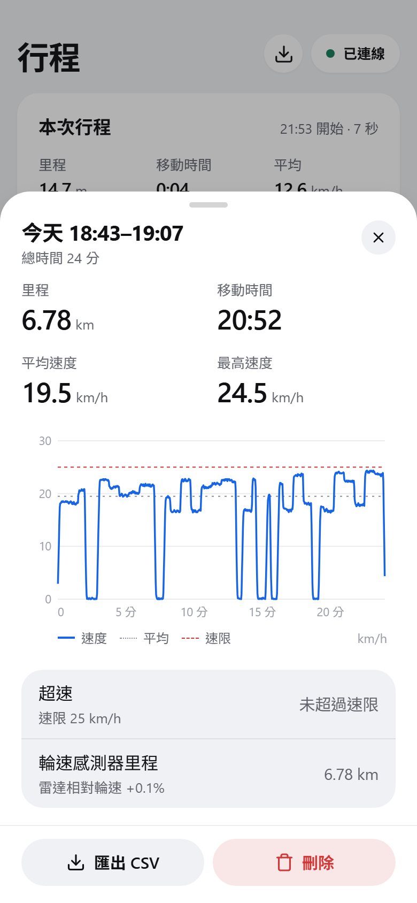
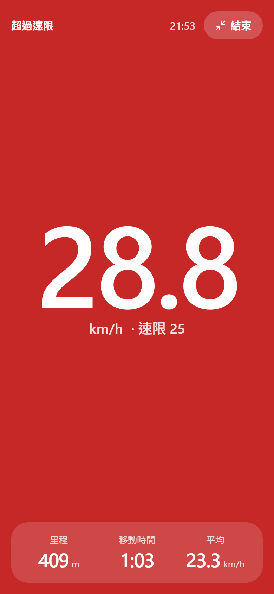
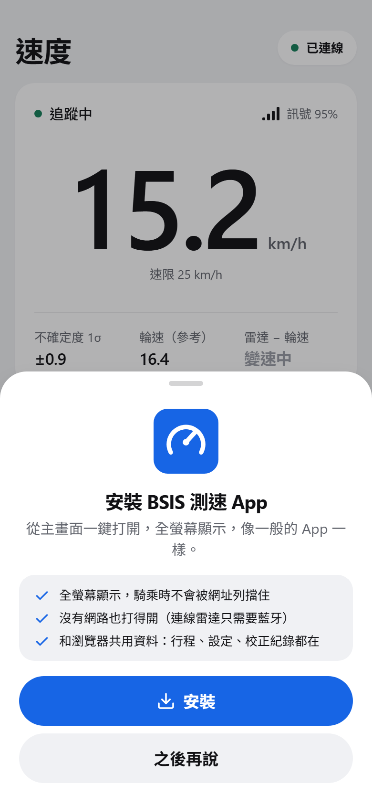
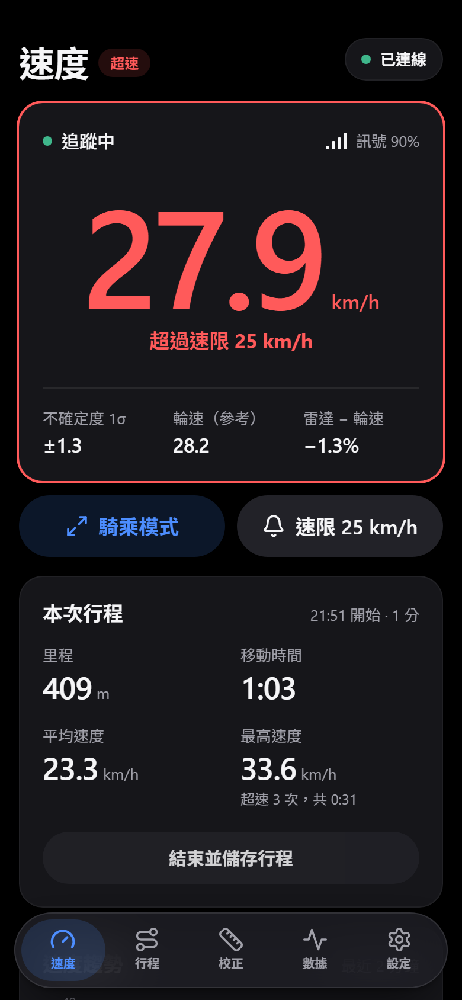
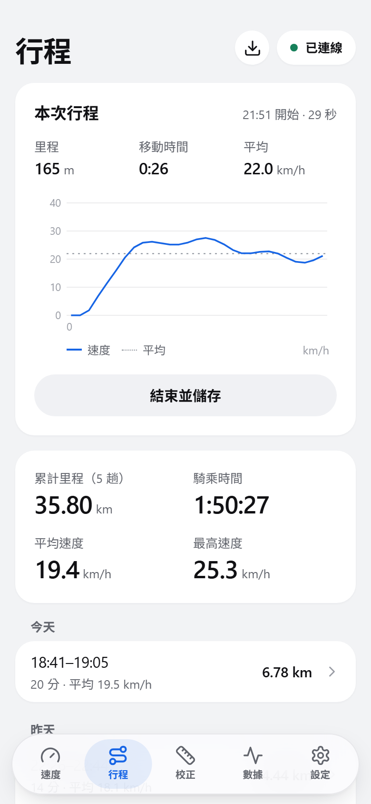
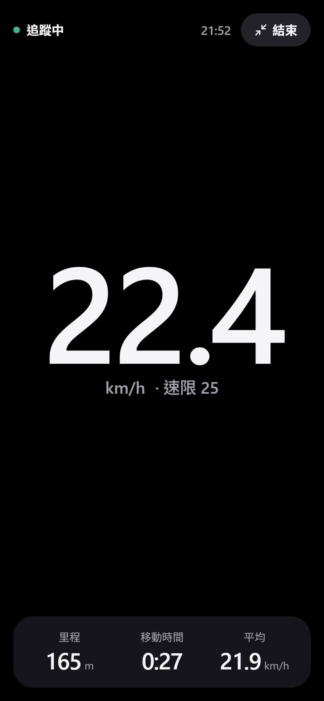
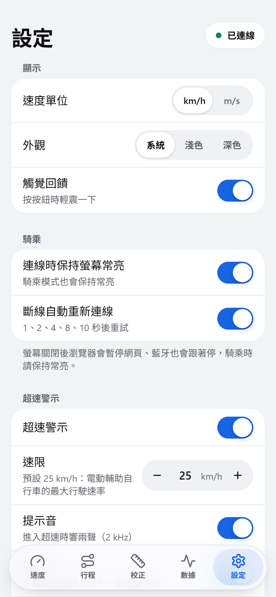
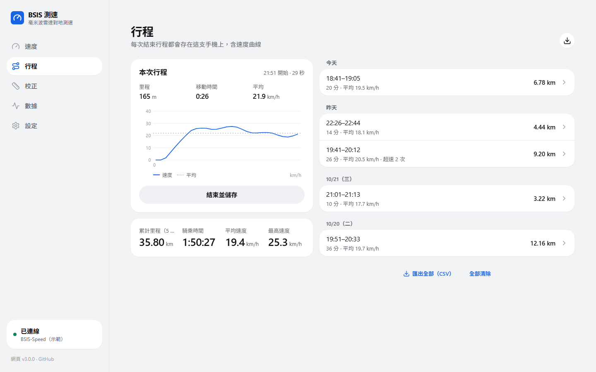

# 網頁：BSIS 測速

對地測速雷達的顯示與設定端。以 **Web Bluetooth** 連線 ESP32，即時顯示對地速度、行程、校正與診斷資料。可以直接用瀏覽器開，也可以安裝成 App（PWA）。

- 正式網址：<https://bsis.mingchen.dev>
- 示範模式（不需要硬體，模擬一段城市騎乘與幾筆行程紀錄）：<https://bsis.mingchen.dev/?demo>

<p align="center">
  
  
  
  
</p>

## 頁面

| 分頁 | 內容 |
| --- | --- |
| 速度 | 對地速度（大字）、量測狀態與訊號品質、不確定度、輪速參考值與差異；騎乘模式；速限快速設定（開關、速限、提示音、震動、測試）；本次行程（里程、移動時間、平均、最高、超速）；最近 2 分鐘的速度趨勢（含速限線） |
| 行程 | 本次行程與即時速度曲線、累計（里程、時間、平均、最高）、行程紀錄（依日期分組）；行程詳情：速度曲線（可以用手指查看每個時間點）、超速、輪速里程比對、匯出 CSV、刪除；全部匯出 CSV |
| 校正 | 設定進度（連線、安裝幾何、校正係數、測速上限、輪速感測器，依裝置目前的參數判斷）、安裝幾何（附即時示意圖）、校正係數（已知距離／輪速感測器，多趟依距離加權合併）、精度驗證（雷達 vs 輪速） |
| 數據 | 記錄 CSV、即時資料框、距離 × 徑向速度散佈圖、判斷統計、指令主控台。手機用分段切換（資料框／圖表／主控台），電腦兩欄攤開 |
| 設定 | 顯示（單位、外觀、觸覺回饋）、騎乘（螢幕常亮、自動重連）、超速警示、裝置參數（雷達門檻、測速上限、輪周長）、維護、App（安裝、離線、版本與更新）、資料（備份、匯入、清除）、文件 |
| 騎乘模式（`#/ride`） | 手機裝在龍頭上用的全螢幕儀表：速度盡量大、狀態一行、本次行程三個數字；超速時整個畫面變紅；橫放時左右排列；保持螢幕常亮，Android 會進入全螢幕 |

- 手機（< 1024 px）：大標題頁面、浮動分頁列（打字時收起來）；捲過大標題後上方出現縮小的頁首。每一頁右上角是連線狀態，點了打開連線面板。
- 電腦（≥ 1024 px）：左欄（分頁、連線、版本）＋雙欄內容。
- 分頁同步到網址（`#/speed`、`#/trips`、`#/calibrate`、`#/data`、`#/settings`）。換分頁不留瀏覽紀錄，Android 的返回鍵會先關掉面板、離開騎乘模式，再離開 App。
- 超速警示的規則、依據與限制見 [docs/SPEED_ALERT.md](../docs/SPEED_ALERT.md)；匯出檔與備份檔的格式見 [docs/PROTOCOL.md](../docs/PROTOCOL.md) §7。

## 截圖

示範模式的模擬資料，`npm run screenshots` 產生（手機 390 × 844 的 2 倍、電腦 1440 × 900）。

| 手機 | | | |
| --- | --- | --- | --- |
|  |  |  |  |
| 速度（淺色） | 速度：超速 | 行程 | 校正：設定進度 |
|  |  |  |  |
| 騎乘模式 | 設定 | 行程詳情 | 安裝提醒（Android Chrome） |

<p>
  
  
</p>

## Web App（PWA）

| 項目 | 做法 |
| --- | --- |
| 安裝提醒 | 用瀏覽器打開就跳出「安裝 BSIS 測速 App」（每次打開一次）。「之後再說」：這次不再出現；「已經安裝了」或照步驟做完按「完成」：30 天不提醒。已經是 App、或 Android 知道裝過了（`getInstalledRelatedApps`、主畫面的 App 記過）就不提醒。有面板開著、正在打字、騎乘模式、正在騎（> 1 m/s）時先等一下 |
| 依瀏覽器的教法 | Android Chrome、電腦 Chrome／Edge：一鍵「安裝」（`beforeinstallprompt`）。Samsung、Firefox：教選單。iPhone Safari：分享 → 加入主畫面（iOS 26 的分享在網址列旁的「⋯」）。macOS Safari 17 以上：檔案 → 加入 Dock。LINE（`openExternalBrowser=1`）、Facebook、Instagram 等 App 內建的瀏覽器：改用瀏覽器打開、複製網址 |
| iPhone | Safari 與主畫面的 App 都不支援 Web Bluetooth，提醒裡會說明連線要用 Bluefy。在 Bluefy 這類有藍牙的 iOS 瀏覽器裡不提醒：加到主畫面的 App 會改用 Safari 的引擎，反而不能連線 |
| 離線 | Service Worker（`public/sw.js`）照建置時產生的 `precache.json` 把這一版的檔案全部存好；換頁先問網路，沒網路或 3 秒沒回應用存的。每次有網路打開都檢查新版，全部存好才換過去，離線時永遠是完整的一版 |
| 新版本 | 每次回到前景、每 30 分鐘比對 `/version.json`。不自動重新載入（會中斷藍牙），頁面上方提示「有新版本」，連線中會註明停車時再更新 |
| 開場畫面 | 從主畫面打開 App 時，接在系統的啟動畫面後面（同樣的藍底與圖示，`index.html` 的 `#launch`），內容畫好就淡出 |
| manifest | `public/manifest.json`：`start_url` `/#/speed`、`launch_handler: focus-existing`（再點圖示回到原本的視窗，不中斷藍牙）、捷徑（騎乘模式、行程、校正）、安裝視窗的截圖（`public/screenshots/`）。底色 `#1765e5` 要和開場畫面一樣 |
| 圖示 | `public/icons/icon.svg`（圓角）、`icon-maskable.svg`（滿版）是原始檔；PNG 由 headless Chrome 轉出（192、512、maskable 512、apple-touch 180） |

## 設計系統

和 Lodestar 同一套設計語言：同樣的語意化名稱、層次與元件形狀，BSIS 用藍色當重點色。設計基準（design tokens）集中在 `src/index.css`，元件只用語意化名稱，深淺色只在這裡切換。

| 類別 | 名稱 |
| --- | --- |
| 層次 | `bg`（頁面）→ `surface`（卡片，不透明）→ `surface-2`、`surface-3`（卡片裡的輸入框、分段控制、按下）；浮在內容上的導覽用 `.chrome`（半透明材質） |
| 線 | `line`（分隔線）、`line-strong`（座標軸） |
| 文字 | `ink`、`muted`（≥ 4.5:1）、`faint`（提示、停用） |
| 重點色 | `tint`（連結、選中、雷達資料線）、`tint-solid`（主要按鈕底色，白字 ≥ 4.5:1）、`tint-soft`（選中的淡底） |
| 狀態 | `ok`、`warn`、`bad`、`bad-solid`（騎乘模式超速的底色）；`ref`（參考值資料線） |
| 字級 | `caption` 12、`footnote` 13、`subhead` 15、`body` 16、`headline` 17、`title` 20、`stat` 26 px；`.large-title` 30 px；`.display` 主速度 |
| 形狀 | 卡片 20 px 圓角；按鈕、分段控制、步進器、開關是膠囊；面板 28 px 圓角 |

設計原則：
- 中性灰階＋一個重點色。綠、黃、紅只表示狀態；不用漸層、光暈、彩色的圖示底。
- 內容層不透明、不加陰影；只有浮在內容上的元件（分頁列、縮小的頁首、提示訊息、面板）有半透明材質或很淡的陰影。系統要求減少透明度時改成不透明。
- 觸控：按鈕至少 44 px 高（主要動作 52 px）、列至少 52 px；輸入框的字 16 px（iPhone 小於 16 px 會放大頁面）；步進器按住不放會連續調整；按鈕在 Android 上有輕微的觸覺回饋（可在設定關閉）。
- 數字一律等寬（`.num`），原始資料用等寬字型。
- 說明文字短，放在欄位下方；需要確認的動作用底部面板（`ConfirmSheet`），不用瀏覽器的 confirm。
- 預設跟隨系統的深淺色。

| 元件（`src/ui/kit`） | 用途 |
| --- | --- |
| `Card`、`Section`、`ListGroup`、`Row` | 卡片；區塊標題＋內容；設定頁那種群組列表 |
| `Button`、`IconButton` | `primary`、`tinted`、`secondary`、`plain`、`danger`；`sm` 36、`md` 44、`lg` 52 px |
| `Stepper`、`Segmented`、`Switch`、`Select`、`TextField` | 表單 |
| `Sheet`、`ConfirmSheet` | 手機是底部面板（拖把手往下拉、返回鍵關閉），電腦是置中對話框 |
| `Stat`、`KeyValue`、`Notice`、`Badge`、`StatusDot`、`SignalBars`、`EmptyState` | 顯示 |
| `useBackToClose`、`lockScroll`（`layers.ts`） | 疊在頁面上的一層：返回鍵關閉、鎖住後面的捲動（全站共用計數） |

## 技術

React 19、TypeScript（strict）、Vite、Tailwind CSS 4、Zustand、Vitest、ESLint；不依賴圖表、圖示、動畫函式庫（圖示是內嵌的 Lucide 圖形，動畫用 CSS 轉場）。

## 架構：分層，相依只往下

```text
src/
├─ domain/          領域層：純 TypeScript，不碰瀏覽器 API，全部有單元測試
│                   協定解析與指令（protocol）、行程統計與累計（trip）、行程的速度曲線（trace）、
│                   校正與比對（calibration）、超速判斷（overspeed）、備份檔（backup）、
│                   藍牙分段重組（lineAssembler）、單位與格式（units）
├─ infrastructure/  基礎設施層：Web Bluetooth（NUS、自動重連、寫入排隊）、示範模式（DemoTransport、示範行程）、
│                   PWA（pwa：Service Worker、安裝事件、新版本；install：安裝提醒的判斷）、
│                   localStorage、CSV、螢幕常亮、提示音與震動（alertOutput）
├─ application/     應用層：Zustand 狀態（radar、trip、calibration、settings、overspeed、toast）、
│                   錯誤訊息繁中化、container.ts（組裝根：唯一知道具體實作的地方）
└─ ui/
   ├─ kit/          設計系統（上表）——頁面只用這些元件
   ├─ shell/        外框：分頁與網址、浮動分頁列、左欄、頁首、連線面板、安裝提醒、橫幅
   ├─ features/     頁面：speed、trips、calibrate、data、settings、ride（騎乘模式）、common
   ├─ widgets/      SpeedChart、TraceChart、ScatterPlot、MountDiagram（SVG）
   └─ hooks/
```

存在這台裝置上的資料（localStorage）：

| 鍵 | 內容 |
| --- | --- |
| `bsis.settings.v1` | 偏好設定（`index.html` 開頭的主題腳本也讀它） |
| `bsis.trips.v1` | 行程紀錄，最多 200 筆，每筆含速度曲線（約 4 KB） |
| `bsis.trip.current.v1` | 本次行程，每 5 秒與離開頁面時存一份：2 小時內重新打開就接續（ESP32 沒重開機時中間騎的距離也算），太久就存進紀錄 |
| `bsis.calibration.v1` | 校正的趟次與上次套用 |
| `bsis.installed`、`bsis.install.claimed` | 安裝提醒用的時間 |

示範模式（`?demo`）的行程紀錄是模擬的，不會寫進 `bsis.trips.v1`。

## 指令

```bash
npm install
npm run dev          # 開發伺服器（localhost 可使用 Web Bluetooth；加 ?demo 看示範資料）
npm test             # 單元測試（Vitest）
npm run lint         # ESLint
npm run build        # 型別檢查 + 產生 dist/（含 precache.json、version.json）
npm run preview      # 預覽 build 結果（Service Worker 只在這裡和正式環境註冊）
npm run screenshots  # 重拍 docs/images 與 public/screenshots（要先 npm run dev -- --port 5180）
```

- 版本號只在 `package.json` 維護，建置時注入成 `__APP_VERSION__`；`__BUILD_ID__` 是這次建置的代號（新版本通知用）。
- 截圖模式 `?screenshot`：不顯示提示訊息、示範橫幅、安裝提醒與新版本通知；`?screenshot&install` 直接打開安裝提醒。

## 瀏覽器支援

| 瀏覽器 | 連線雷達 | 安裝成 App |
| --- | --- | --- |
| Android Chrome | 支援 | 一鍵安裝；主畫面的 App 也能連線 |
| 電腦 Chrome／Edge（Windows、macOS，需有藍牙） | 支援 | 一鍵安裝 |
| iPhone Safari | 不支援，改用 Bluefy | 可以加入主畫面（看示範與行程），一樣不能連線 |
| iPhone Bluefy | 支援 | 不要加入主畫面（會變成 Safari 的引擎） |
| Brave | 預設關閉，需在 `brave://flags` 開啟 Web Bluetooth | 支援 |
| Firefox | 不支援 | Android 可以加入主畫面 |

網頁必須以 HTTPS（或 localhost）開啟，瀏覽器才允許使用藍牙與 Service Worker。

## 資料格式

見 [docs/PROTOCOL.md](../docs/PROTOCOL.md)。網頁對應韌體主版本 3；連上 2.x（後方來車偵測版）時會提示更新韌體。

## 部署

部署在 Zeabur，連結 GitHub repo 的 `main` 分支、根目錄 `web/`：**push 到 `main` 就會自動建置並上線**。Service Worker 的檔案（`sw.js`）不需要為了新版改名：它每次有網路都會照 `precache.json` 存新版。
